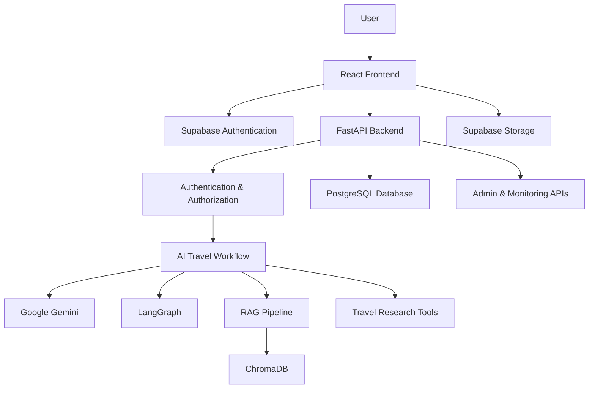

# NovaTrip — AI Travel Concierge ✈️

**Your intelligent AI-powered travel planning companion.**

NovaTrip is a full-stack AI travel application that helps users discover destinations, research travel information, generate personalized itineraries, and manage their travel plans through an interactive interface.

It combines AI agents, retrieval-augmented generation (RAG), travel research integrations, and secure user authentication to provide a unified travel-planning experience.

## 🌍 Live Application

- **Frontend:** https://novatrip-frontend.vercel.app/
- **Backend API:** https://novatrip-api-r3sc.onrender.com
- **API Documentation:** https://novatrip-api-r3sc.onrender.com/docs
- **GitHub Repository:** https://github.com/Jayesh0205/AI-Travel-Concierge

## ✨ Features

### 🤖 AI Travel Assistant
- AI-powered travel conversations using Google Gemini.
- Intelligent travel planning with LangGraph workflows.
- Personalized itinerary generation.
- Streaming responses and travel-planning progress updates.
- Friendly handling of API errors and temporary service failures.

### 🧠 RAG-Based Travel Knowledge
- Retrieval-Augmented Generation using ChromaDB.
- Travel document loading, splitting, embedding and retrieval.
- Context-aware responses using relevant travel information.

### ✈️ Travel Research
- Flight search integration.
- Weather information.
- Web-based travel research.
- Destination discovery and travel recommendations.

### 👤 Authentication & Profile
- User authentication with Supabase Auth.
- Protected application features.
- User profile management.
- Profile avatar uploads using Supabase Storage.

### ❤️ Saved Places & Trips
- Save and remove favourite destinations.
- Persistent saved places using PostgreSQL.
- View saved travel plans and trip history.
- Reopen previously generated travel plans.

### 🛡️ Admin Panel
- Protected administrator access.
- Registered-user overview.
- Saved-places overview.
- Administrative statistics.
- Monitoring dashboard for application and API activity.
- Backend-enforced role-based authorization.

### 🎨 User Interface
- Modern React-based interface.
- Responsive layouts.
- Interactive travel dashboard.
- Itinerary copy and TXT export options.
- Loading, error and empty states.

## 🛠️ Technology Stack

| Category | Technologies |
|---|---|
| Frontend | React, Vite, Tailwind CSS |
| Backend | Python, FastAPI |
| AI Model | Google Gemini |
| Agent Framework | LangGraph |
| Knowledge Retrieval | RAG, ChromaDB |
| Authentication | Supabase Auth |
| Avatar Storage | Supabase Storage |
| Database | PostgreSQL, SQLAlchemy |
| API Communication | REST API, Streaming |
| Icons | Lucide React |
| Deployment | Vercel, Render |
| Version Control | Git, GitHub |

## 🏗️ System Architecture



## 📁 Project Structure

```text
AI-Travel-Concierge/
│
├── agent/
│   └── workflow.py
│
├── backend/
│   ├── auth.py
│   └── main.py
│
├── database/
│   └── pg_models.py
│
├── rag/
│   ├── embeddings.py
│   ├── loader.py
│   ├── qa.py
│   ├── retriever.py
│   ├── splitter.py
│   └── vectorstore.py
│
├── travel_api/
│
├── frontend/
│   ├── src/
│   │   ├── components/
│   │   │   ├── AdminSavedPlaces.jsx
│   │   │   ├── AdminUsers.jsx
│   │   │   ├── Profile.jsx
│   │   │   └── SavedPlaces.jsx
│   │   ├── lib/
│   │   ├── App.jsx
│   │   └── main.jsx
│   ├── package.json
│   └── vite.config.js
│
├── data/
├── tests/
├── requirements.txt
├── .env.example
└── README.md
```

*This is a simplified overview of the main project modules.*

## 🚀 Getting Started

### Prerequisites

- Python 3.10 or a compatible project-supported version.
- Node.js and npm.
- Git.
- PostgreSQL.
- Google Gemini API credentials.
- Supabase project credentials.

### 1. Clone the Repository

```cmd
git clone https://github.com/Jayesh0205/AI-Travel-Concierge.git
cd AI-Travel-Concierge
```

### 2. Set Up the Backend

Create and activate a virtual environment:

```cmd
python -m venv .venv
.venv\Scripts\activate
```

Install Python dependencies:

```cmd
python -m pip install -r requirements.txt
```

Configure the backend environment variables using the project's `.env.example` file. Add the required database, Gemini and Supabase configuration values.

**Never commit your actual `.env` file.**

### 3. Start the Backend

From the project root:

```cmd
uvicorn backend.main:app --reload
```

Backend development URL:

```text
http://127.0.0.1:8000
```

API documentation:

```text
http://127.0.0.1:8000/docs
```

### 4. Set Up the Frontend

Open another terminal:

```cmd
cd frontend
npm install
```

Create `frontend/.env.local` and configure the frontend variables required by the project. For local backend communication, configure:

```dotenv
VITE_API_URL=http://127.0.0.1:8000
```

Add the required Supabase frontend configuration using the variable names expected by `src/lib/supabase.js`.

### 5. Start the Frontend

```cmd
npm run dev
```

Open the local Vite URL shown in the terminal, usually:

```text
http://localhost:5173
```

## 🔐 Security

NovaTrip uses multiple security measures:

- Supabase Auth for user authentication.
- Backend verification of authentication tokens.
- Role-based authorization for administrative endpoints.
- User-specific access to saved places and travel data.
- Server-side authorization checks for protected operations.
- Environment variables for sensitive credentials.

**Important:** Never expose Supabase service-role keys, database passwords, Gemini API keys or other private credentials in frontend code or public repositories.

## 🧪 Testing

Run the available Python tests from the project root:

```cmd
python -m pytest
```

Check backend syntax:

```cmd
python -m py_compile backend\main.py backend\auth.py
```

Build the frontend:

```cmd
cd frontend
npm run build
```

## 🌐 Deployment

NovaTrip uses separate deployment platforms for its frontend and backend.

| Service | Platform |
|---|---|
| Frontend | Vercel |
| Backend | Render |
| Authentication | Supabase |
| Database | PostgreSQL |
| Avatar Storage | Supabase Storage |

Production environment variables must be configured securely in the corresponding deployment dashboards.

## 🔮 Future Improvements

- Detailed security and user activity audit logs.
- Enhanced administrative analytics.
- More travel and booking integrations.
- Improved RAG document management.
- Additional automated tests.
- Further optimization of AI response time and reliability.

## 👨‍💻 Developer

**Jayesh Gujar**

B.Tech Computer Engineering Student

- GitHub: [Jayesh0205](https://github.com/Jayesh0205)
- Project: [NovaTrip — AI Travel Concierge](https://github.com/Jayesh0205/AI-Travel-Concierge)

---

*NovaTrip — Explore smarter. Plan better. Travel further.* ✈️